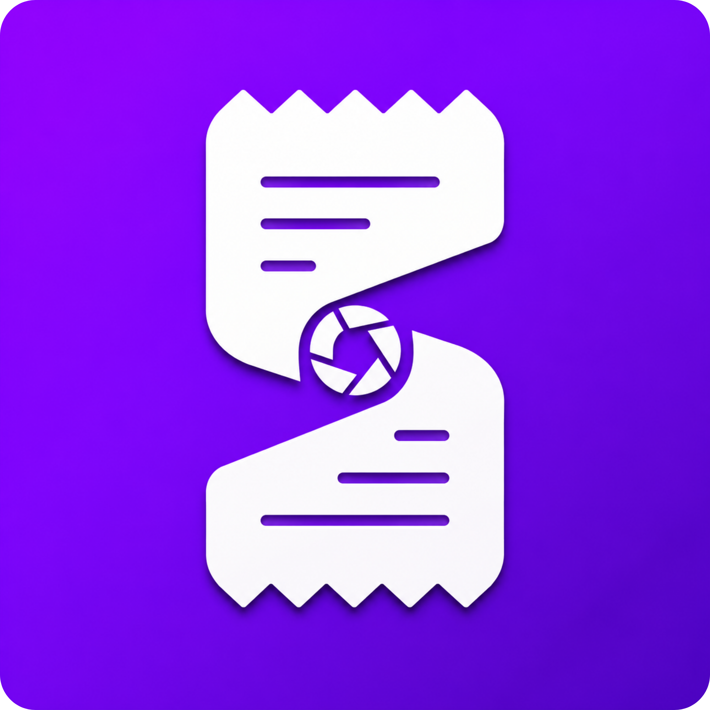
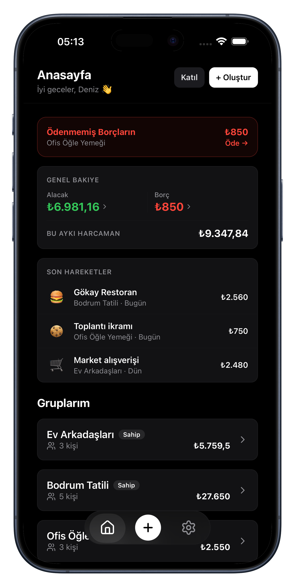
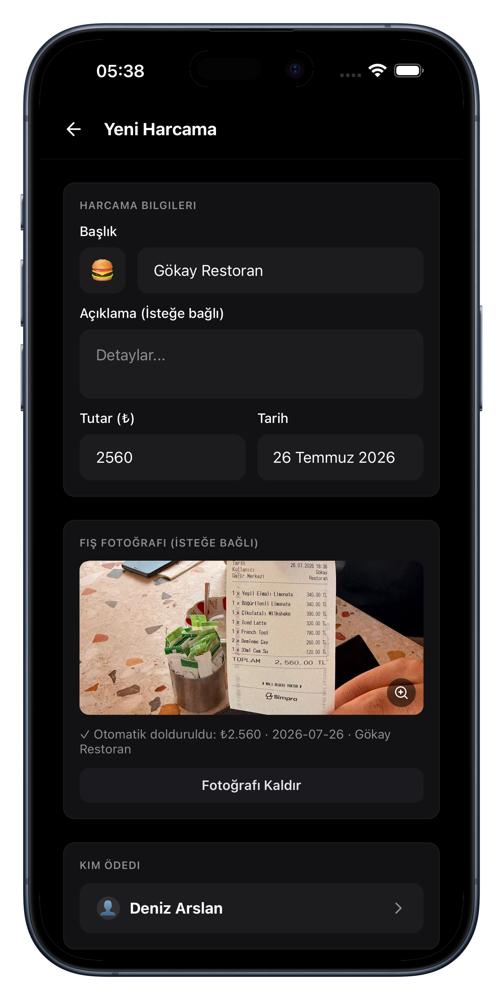
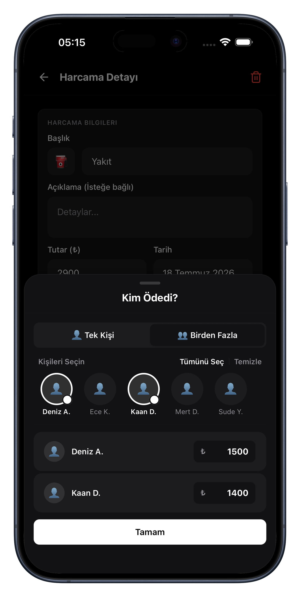
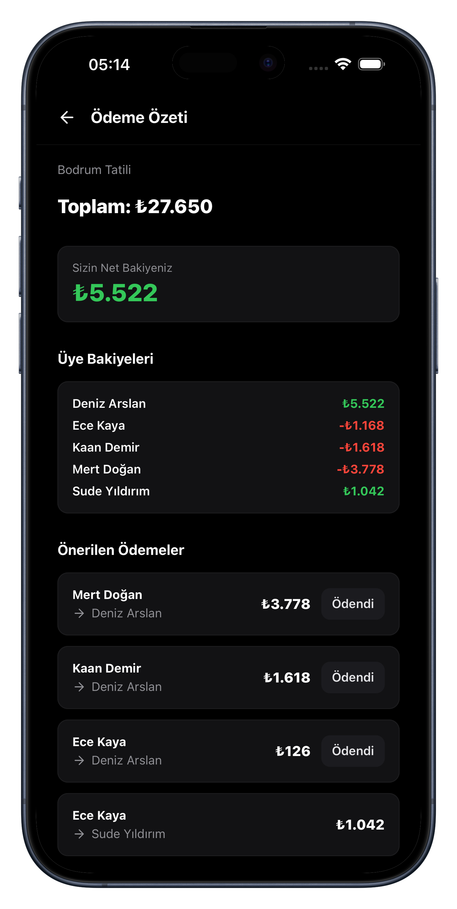
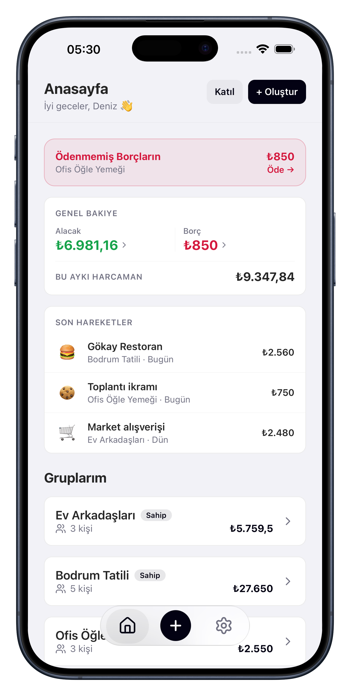

<div align="center">
  
  <h1>
    SplitSnap<br>
    <sub>Snap receipts. Split bills. Settle up effortlessly.</sub>
  </h1>
  <br>
  <a href="https://apple.co/3PWAfUo">
    
  </a>
</div>

<br>
<p align="center">
  
  
  
  
  
  
  
</p>
<br>

## Project Tracking

- **Primary Document:** [`ROADMAP.md`](ROADMAP.md) — post-release backlog, active tasks, and recent updates.
- **Archived School Project:** [School Archive](docs/archive/school/) & [Screenshots](docs/archive/roadmap-screenshots/) (Final report, logs, videos).


## Key Features

<div>
  
  <br><br><br>
  <h3>🏘 Groups & Shared Expenses</h3>
  <p>Create groups with your friends, roommates, or travel buddies. The home screen opens on a single summary: what you are owed, what you owe, how much you have spent this month, and the latest activity across every group. Tap a balance to see exactly which groups it came from.</p>
</div>
<br clear="both"/>
<br>

<div>
  
  <br><br><br>
  <h3>📸 AI-Powered Receipt Scanning</h3>
  <p>Snap a photo of your receipt or pick one from your gallery. The text is read on device, then an AI pass fills in the amount, date, and merchant name for you. If an image turns out not to be a readable receipt, the app tells you instead of quietly guessing.</p>
</div>
<br clear="both"/>
<br>

<div>
  
  <br><br><br>
  <h3>💸 Fair & Flexible Splitting</h3>
  <p>Split an expense equally or type exact amounts per person. When more than one person chipped in, record every payer on the same expense instead of faking it with a second entry. The remaining balance updates as you type, so a split can never quietly fail to add up.</p>
</div>
<br clear="both"/>
<br>

<div>
  
  <br><br><br>
  <h3>📊 Detailed Settlement Summary</h3>
  <p>"Who owes whom, and how much?" Get the answer on a single screen. The suggestions pair the largest debts with the largest credits, so a group settles up in a handful of payments, and tapping any line opens the full breakdown behind it.</p>
</div>
<br clear="both"/>
<br>

<div>
  
  <br><br><br>
  <h3>🌗 Light & Dark</h3>
  <p>Both themes are built as first-class citizens rather than one being an afterthought, and the app follows your system setting automatically.</p>
</div>
<br clear="both"/>

## Requirements

- **Node.js** as pinned in [`.nvmrc`](.nvmrc). That single file is what local shells, the iOS build and EAS Build all read, and `engines` plus `engine-strict` in [`.npmrc`](.npmrc) turn a mismatch into a failed `npm install` rather than a warning. Expo SDK 58 itself only needs 20.19+; the tighter pin is what keeps release builds reproducible.
- **macOS + Xcode** for iOS Simulator
- **Docker** for the local Supabase stack, and the [Supabase CLI](https://supabase.com/docs/guides/cli) (`brew install supabase/tap/supabase`)

## Setup

1. **Install dependencies**

   ```bash
   nvm use        # or: fnm use — reads .nvmrc
   npm install
   ```

   The first line is not optional: `npm install` refuses to run on a Node version outside the pin.

2. **Local backend**

   Development runs against a local Supabase stack, never a hosted project:

   ```bash
   supabase start      # Docker must be running
   supabase db reset   # every migration plus supabase/seed.sql (three test accounts and a group)
   ```

   Then create `.env.development.local` (gitignored, never uploaded to EAS) with the local values from `supabase status`:

   - `EXPO_PUBLIC_SUPABASE_URL=http://127.0.0.1:54321`
   - `EXPO_PUBLIC_SUPABASE_KEY=<the local publishable key>`

   Receipt parsing locally needs an OpenAI key in `supabase/functions/.env` (`OPENAI_API_KEY=…`); without it the app falls back to its on-device parser. The model defaults to `gpt-6-luna` (optional `OPENAI_RECEIPT_MODEL`). Production values live in EAS environment variables and Supabase secrets, not in files. Full details: [`docs/DEVELOPMENT_WORKFLOW.md`](docs/DEVELOPMENT_WORKFLOW.md) §1–§3; migrations and RPCs: [`supabase/README.md`](supabase/README.md); schema: [`docs/DATABASE.md`](docs/DATABASE.md).

3. **Checks**

   ```bash
   npm run check       # TypeScript + ESLint
   npm test            # Jest unit tests (money logic, parsers)
   npm run test:db     # SQL suites against the local stack (RLS, expense RPCs, invites, settlements)
   ```

4. **Run on iOS (development build)**

   This project uses **native modules** (e.g. MMKV). Use a **development build**, not Expo Go:

   ```bash
   npm run ios
   ```

   Or: `npx expo run:ios`

   First run generates native projects via prebuild (if `ios/` is ignored in git, this is expected on each fresh clone). Prebuild also writes `ios/.xcode.env.local` via [`plugins/withXcodeEnvNvm.js`](plugins/withXcodeEnvNvm.js), which is how Xcode's script phases find the `.nvmrc` Node — nothing to set up by hand. The same flow works on a **physical iPhone** (USB or network) with a dev client — not Expo Go.

   To choose a target, run `npm run ios:pick`: it lists every simulator and the connected iPhone in the terminal and builds for whichever you pick. `npm run ios:27` goes straight to the iPhone 17 Pro Max simulator (the App Store screenshot size), booting it first. See [`docs/DEVELOPMENT_WORKFLOW.md`](docs/DEVELOPMENT_WORKFLOW.md) §4 for the run targets, why picking your own phone replaces an App Store install of the app, and how to clear DerivedData after an Xcode upgrade.

## Testing & Release

- **Every pull request** runs the Expo version check, TypeScript, ESLint, the Jest unit tests and the SQL suites in GitHub Actions; `main` accepts nothing that is red. Renovate's dependency PRs go through the same checks, and safe patch updates merge themselves when green.
- **Releases are one button** (Actions → Release): the same checks, a hosted staging database rebuilt from migrations, an EAS simulator build, a [Maestro](https://maestro.mobile.dev) end-to-end flow on an iOS 27 simulator (sign in, add an expense, record a payment, check the balances), then the EAS production build and the upload to TestFlight. A red step stops the chain before anything reaches the App Store.
- Locally, `npm run test:e2e` runs the same Maestro flow against the dev build. Details: [`docs/APP-STORE.md`](docs/APP-STORE.md), [`docs/DEVELOPMENT_WORKFLOW.md`](docs/DEVELOPMENT_WORKFLOW.md) §4.

## Learn more

- [Expo documentation](https://docs.expo.dev/)
- [Expo Router](https://docs.expo.dev/router/introduction/)
- [Supabase + Expo](https://supabase.com/docs/guides/getting-started/tutorials/with-expo-react-native)

## Contact

**Developer:** Bora Kocabıyık  
**Email:** bora@borak.dev  
**Website:** [splitsnap.borak.dev](https://splitsnap.borak.dev)  

If you have any questions, feedback, or need support, feel free to reach out via email or open an `Issue` in this repository.

## License

SplitSnap is **source-available** under the [PolyForm Noncommercial License 1.0.0](LICENSE): you may read, run, study and modify it for any noncommercial purpose, but not use it in a commercial product or service.

- Commits up to and including `e9a77f2` (2026-11-22) were published under the MIT License; copies obtained from those commits keep that license. Everything after is PolyForm Noncommercial.
- **Contributions are welcome.** By opening a pull request you agree that your contribution is licensed to the project owner under these same terms and may also be used by the owner commercially, including in the App Store version of SplitSnap.
